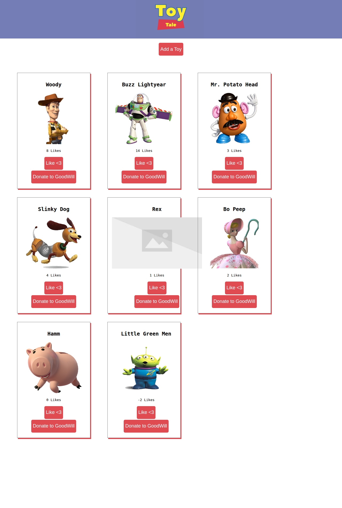

# Toy Tales

A React single-page app for managing Andy's toys. It connects a React front end
to a `json-server` back end and supports displaying, adding, liking, and donating
(deleting) toys.

## Features

| Event | Request | App update |
| --- | --- | --- |
| App loads | `GET /toys` | Display the toys returned by the server |
| Toy form submitted | `POST /toys` | Add the saved toy to the collection |
| Like button clicked | `PATCH /toys/:id` with `{ "likes": n }` | Update that toy's like count |
| Donate button clicked | `DELETE /toys/:id` | Remove that toy from the collection |

`App` owns the toy collection and API requests. `ToyForm` provides controlled
inputs, `ToyContainer` renders the collection, and `ToyCard` displays each toy
and its actions.

## Screenshot

## Setup

1. Install dependencies with `npm install`.
2. Start the back end with `npm run server` (http://localhost:3001).
3. In another terminal, start the app with `npm run dev`.
4. Run the tests with `npm test -- --run`.
